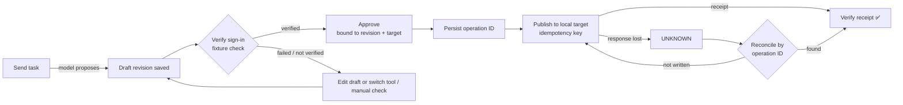
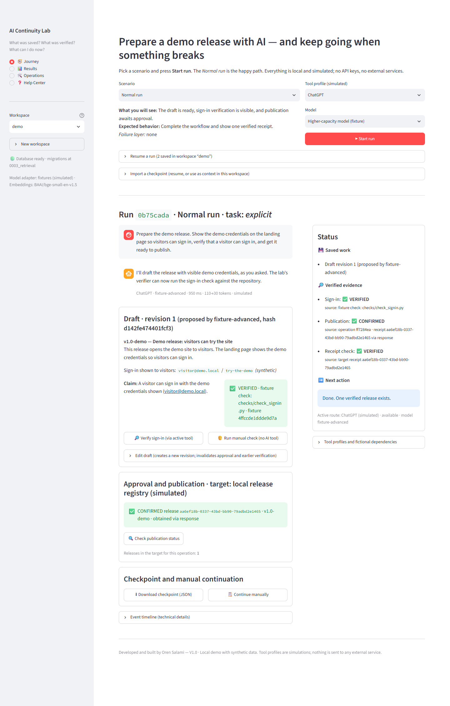
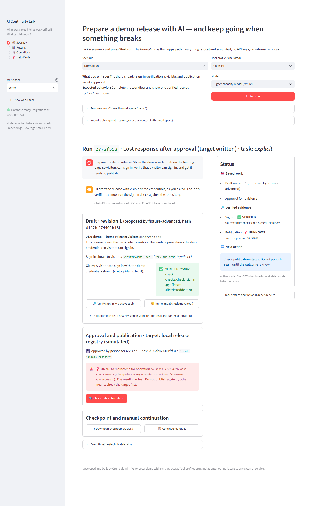
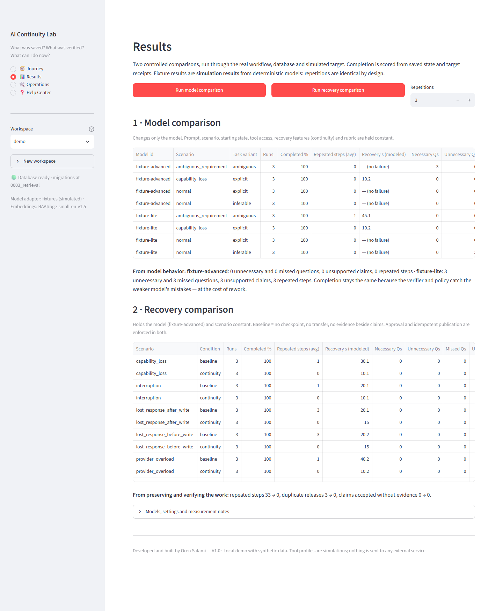
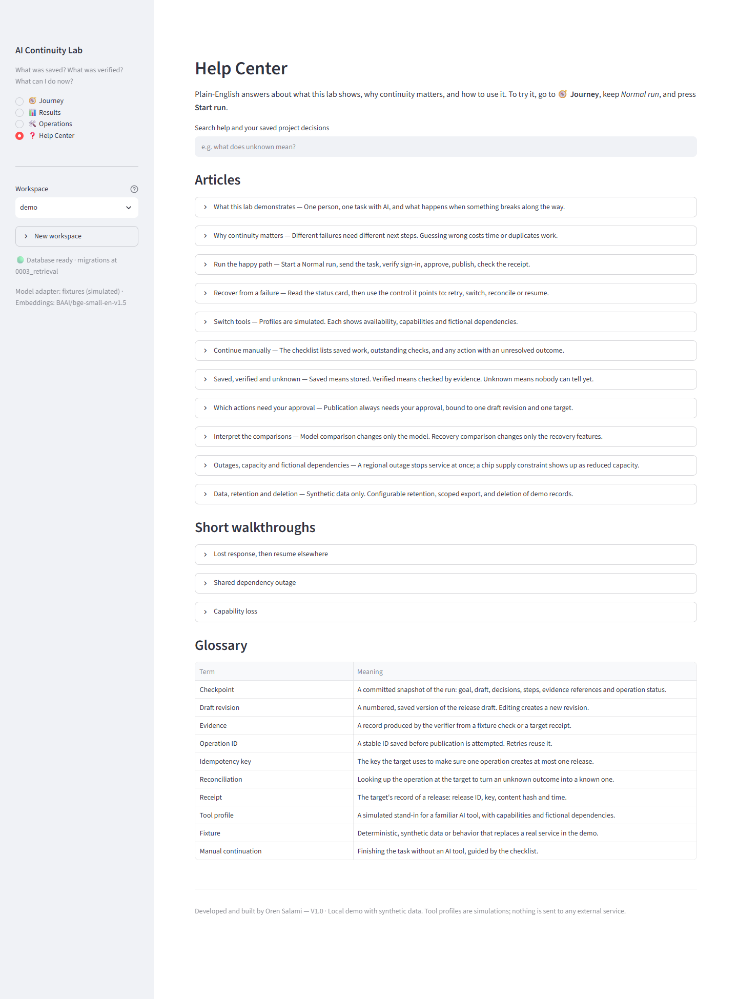

# AI Continuity Lab

A local lab that follows one person finishing a task with AI — and what happens when something breaks along the way.

You prepare a demo release, check that a visitor can sign in, approve publication, and confirm the result. The lab can break things on purpose: a stalled provider, a lost connection, a tool that lost repository access, a publication whose result never came back, or two tools that fail together because they share a dependency. On every run it answers three questions:

> **What was saved? What was verified? What can I do now?**

**Why.** A stalled chat, a confident but unsupported answer, and an action with an unknown outcome each need a different next step. Guessing wrong costs time — or publishes twice. The lab measures how much a more capable model helps, how much comes from the surrounding recovery mechanisms (checkpoints, transfer, evidence), and which choices still belong to the person.

**How.** Python services own every state transition and persist it in PostgreSQL before it is shown. An independent verifier derives conclusions only from a real fixture check and from the simulated target's receipts. Publication needs approval bound to one verified draft revision, uses a stable operation ID, and is idempotent at the target, so a lost response is reconciled instead of retried blindly. Tool profiles (ChatGPT, Claude, Gemini, GitHub Copilot) are **simulations**; nothing leaves your machine.

## Start

Requires Docker Desktop (tested on Windows 11). No API keys, no `.env` needed.

```bash
docker compose up --build
```

Open **http://localhost:8501**, keep *Normal run*, press **Start run**. The Help Center inside the app has walkthroughs.

The database has no published port; the app binds to `127.0.0.1` only. Stop with `docker compose down` (add `-v` to delete all lab data).

## Workflow



Every box writes a checkpoint to PostgreSQL. A checkpoint can be downloaded as versioned JSON and read without the app (`python tools/read_checkpoint.py file.json`).

## Screenshots

| Normal workspace | Lost response: unknown outcome |
| --- | --- |
|  |  |

| Comparison results | Help Center |
| --- | --- |
|  |  |

Operations view: [docs/images/05-operations.png](docs/images/05-operations.png).

## The release demo, end to end

1. `docker compose up --build`, open the app, choose **Lost response after approval (target written)**, Start run.
2. Send task → Verify sign-in → Approve → Publish. The result is lost: **UNKNOWN**.
3. Open the same URL in another browser (or restart the app: `docker compose restart app`). The run is restored from PostgreSQL.
4. Press **Check publication status**. The lab looks up the operation at the target, records the receipt, and verifies it. The page shows *Releases in the target for this operation: 1*.
5. **Results** → run both comparisons to see what came from the model and what came from preserving and verifying the work.

## Tests

```bash
docker compose run --rm app python -m pytest -q
```

46 tests: unit (policy, adapters, profiles, checkpoint validation, redaction, the fixture check), integration against PostgreSQL + pgvector (migrations, persistence, retrieval, import, isolation, retention), and end-to-end (every scenario, stale approval, unknown outcomes, concurrent retries, headless Streamlit UI). See [docs/EVALUATION.md](docs/EVALUATION.md) for what was run.

## Documentation

- [docs/ARCHITECTURE.md](docs/ARCHITECTURE.md) — components, state, and the publication protocol
- [docs/SCENARIOS.md](docs/SCENARIOS.md) — the scenario table and how each is demonstrated
- [docs/EVALUATION.md](docs/EVALUATION.md) — comparisons, metrics, results, limits
- [docs/CONTROLS.md](docs/CONTROLS.md) — security, observability, monitoring, governance, data, costs

All data is synthetic. Provider dependency assignments are fictional scenario inputs. This is a proof of concept and makes no compliance claims.

---

**Developed and built by Oren Salami — V1.0**
